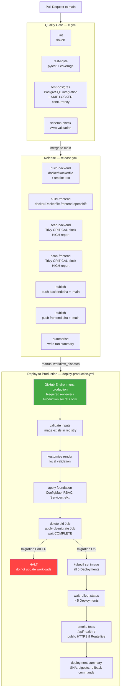

# ArtistHub CI/CD Architecture

Phase 8G — GitHub Actions build, scan, publish, and OpenShift deployment pipeline.

---

## Pipeline Overview



---

## CI Quality Gate (`ci.yml`)

Runs on **every push and pull request to `main`**.
No deployment credentials are available to this workflow.

| Job | What it does | Blocks merge if fails? |
|---|---|---|
| `lint` | `flake8 app consumers run*.py tests/` | Yes |
| `test-sqlite` | `pytest --cov=app --cov-fail-under=80` against SQLite | Yes |
| `test-postgres` | PostgreSQL service container: `flask db upgrade` then pytest `test_postgres_integration.py` + `test_outbox_relay_concurrency.py` | Yes |
| `schema-check` | `python kafka/validate_schemas.py` (48 Avro structural checks) | Yes |

The `test-postgres` job spins up a `postgres:15-alpine` service container and validates:
- All 23 PostgreSQL integration tests
- All 12 `SELECT FOR UPDATE SKIP LOCKED` concurrency tests for the outbox relay

This is the only environment where PostgreSQL locking behavior is genuinely validated.
**SQLite skips of these tests do not count as validation of SKIP LOCKED behavior.**

---

## Release Pipeline (`release.yml`)

Runs on **push to `main`** (after the quality gate passes via branch protection rules).
Also triggerable via `workflow_dispatch` for manual re-publish.

### Jobs

1. **Quality re-run** — lint, test-sqlite, test-postgres, schema-check (same gates as CI).
   Deploy cannot proceed unless all four pass.

2. **build-backend** — builds `docker/Dockerfile` using BuildKit/buildx with GHA cache.
   Includes OCI labels: `revision`, `source`, `created`, `title`.
   Runs a container smoke test (`curl /api/health`) before saving the image.

3. **build-frontend** — builds `docker/Dockerfile.frontend.openshift` (OpenShift CoreDNS config).

4. **scan-backend / scan-frontend** — Trivy vulnerability scan:
   - `CRITICAL` findings → **exit 1 (blocks publish)**
   - `HIGH` findings → SARIF report uploaded as artifact, non-blocking
   - `MEDIUM`/`LOW` → not scanned (reduce noise; revisit at Phase 8H)
   - `--ignore-unfixed` skips CVEs with no available fix (reduces false positives)
   - To add exceptions: create `.trivyignore` with a dated justification comment
     per CVE ID. Review documented in `docs/security-exceptions.md`.

5. **publish** — skipped if `REGISTRY_HOST`/`REGISTRY_USERNAME`/`REGISTRY_PASSWORD`
   secrets are not set. This allows build+scan to work even without a registry.
   When secrets are set:
   - Pushes `<registry>/<namespace>/backend:<sha>` (immutable)
   - Pushes `<registry>/<namespace>/backend:main` (mutable convenience tag)
   - Same for frontend
   - Outputs image digests to the run summary

6. **summarise** — always runs; writes commit SHA, workflow run ID, and deploy instructions.

### Image naming

| Image | Immutable tag | Mutable tag |
|---|---|---|
| Backend | `<registry>/<ns>/backend:<full-git-sha>` | `<registry>/<ns>/backend:main` |
| Frontend | `<registry>/<ns>/frontend:<full-git-sha>` | `<registry>/<ns>/frontend:main` |

Production deployments **always reference the SHA tag**, never `:main` or `:latest`.
Traceability: SHA → GitHub commit → CI run → image digest → running pod.

---

## Production Deployment (`deploy-production.yml`)

**Trigger: manual `workflow_dispatch` only.**

Operators fill in:
- `image_sha` — the full git SHA of the images to deploy (must have been published by `release.yml`)
- `reason` — deployment rationale (appears in run summary and audit trail)
- `skip_smoke` — `true` only when the cluster has no public Route yet

### GitHub Environment: `production`

The `deploy-production.yml` job runs in the `production` GitHub Environment, which provides:

1. **Required reviewers** — set in GitHub → Settings → Environments → production.
   Configure at least one required reviewer so all production deployments have a second pair of eyes.

2. **Environment-scoped secrets** — production secrets (`OPENSHIFT_TOKEN`, `REGISTRY_PASSWORD`, etc.)
   live **in the `production` Environment**, not in repository-level secrets.
   This means PR workflows and `release.yml` (which runs outside the environment) can **never** access
   production credentials.

3. **Deployment history** — GitHub tracks every deployment, who approved it, and the outcome.

### Setting up the `production` Environment

```
GitHub Repository → Settings → Environments → New environment
  Name: production
  Required reviewers: [list team leads]
  Deployment branches: main only (optionally: tagged releases only)
  Secrets:
    OPENSHIFT_SERVER     = https://api.<cluster>.<domain>:6443
    OPENSHIFT_TOKEN      = <sa-cicd-deploy token — see below>
    OPENSHIFT_NAMESPACE  = artisthub
    REGISTRY_HOST        = ghcr.io (or quay.io, or OCP internal registry)
    REGISTRY_NAMESPACE   = your-org/artisthub
    REGISTRY_USERNAME    = your-registry-service-account
    REGISTRY_PASSWORD    = your-registry-token  (never print this)
```

### Repository-level secrets (non-production, accessible to release.yml)

```
REGISTRY_HOST        = ghcr.io
REGISTRY_NAMESPACE   = your-org/artisthub
REGISTRY_USERNAME    = your-registry-service-account
REGISTRY_PASSWORD    = your-registry-token
```

These allow `release.yml` to push images on merge without requiring environment approval.
They do **not** include `OPENSHIFT_TOKEN` — the registry push and the cluster deploy are separate.

---

## OpenShift Authentication Model

### `sa-cicd-deploy` ServiceAccount

Defined in [`openshift/base/rbac-cicd.yaml`](../openshift/base/rbac-cicd.yaml).

This is the **only identity** used by GitHub Actions to interact with the cluster.
It has the minimum permissions required for deployment and nothing more.

#### Minimum RBAC granted

| Resource | Verbs | Reason |
|---|---|---|
| `deployments` | get, list, patch, update | `kubectl set image`, rollout status |
| `deployments/status` | get | rollout status reads this sub-resource |
| `replicasets` | get, list | rollout status |
| `pods` | get, list | pod inspection, port-forward |
| `pods/log` | get | migration failure diagnosis |
| `pods/portforward` | create | smoke test port-forward |
| `jobs`, `jobs/status` | get, list, create, delete, patch | db-migrate Job lifecycle |
| `configmaps` (artisthub-config only) | get, list, create, update, patch | idempotent apply |
| `services` | get, list, create, update, patch | idempotent apply |
| `networkpolicies` | get, list, create, update, patch | idempotent apply |
| `endpoints` | get, list | rollout status |
| `routes` | get, list, create, update, patch | Route apply |
| `namespaces`, `serviceaccounts`, `roles`, `rolebindings` | get, list | read only |

#### NOT granted

- `cluster-admin` — never
- `get`/`list`/`watch` Secrets — the pipeline never reads application secrets
- `anyuid` SCC — not needed
- Cross-namespace access — scoped to `artisthub` namespace only

### Creating the deploy token (one-time setup)

```bash
# Apply the RBAC manifest first
kubectl apply -f openshift/base/rbac-cicd.yaml -n artisthub

# Create a long-lived token secret
kubectl create secret generic sa-cicd-deploy-token \
  --type=kubernetes.io/service-account-token \
  -n artisthub \
  --dry-run=client -o yaml | \
  kubectl annotate --local -f - \
  kubernetes.io/service-account.name=sa-cicd-deploy \
  -o yaml | kubectl apply -f -

# Extract the token value (add to GitHub production Environment → OPENSHIFT_TOKEN)
kubectl get secret sa-cicd-deploy-token -n artisthub \
  -o jsonpath='{.data.token}' | base64 -d
```

### Token rotation

```bash
kubectl delete secret sa-cicd-deploy-token -n artisthub
# Re-create (same command as above)
# Update OPENSHIFT_TOKEN in GitHub Environment secrets
```

**Recommended rotation cadence:** every 90 days or on any personnel change.

---

## Deployment Order

The `deploy-production.yml` workflow enforces this exact sequence:

```
1.  validate inputs (image exists in registry)
2.  kustomize render validation (offline)
3.  apply foundation (namespace, RBAC, ConfigMap, Services, NetworkPolicies)
4.  delete old db-migrate Job
5.  apply db-migrate Job with new image
6.  kubectl wait job/db-migrate --for=condition=complete --timeout=180s
        → FAIL: log migration output, HALT — do not update workloads
        → PASS: continue
7.  kubectl set image (backend, frontend, outbox-relay, analytics, notification)
8.  kubectl rollout status × 5 (300s timeout each)
9.  smoke tests (port-forward /api/health + /)
10. deployment summary written to GitHub run summary
```

---

## Rolling Update Strategy

### Backend (maxSurge=1, maxUnavailable=0)

Zero-downtime deployment. The extra replica means 3 backend pods run briefly
during the update. Flask sessions are stateless (cookie-signed), so any pod
handles any request correctly. The `readinessProbe` on `/api/health` ensures
traffic is only routed to pods that have connected to PostgreSQL.

### Frontend (maxSurge=1, maxUnavailable=0)

Same zero-downtime policy. nginx serving static files is fully stateless.

### Outbox Relay (maxSurge=1, maxUnavailable=1)

During rollout: briefly runs 3 relay instances (2 old + 1 new). SKIP LOCKED
ensures the extra relay cannot duplicate any row that is already locked by an
old instance. The `maxUnavailable=1` setting means one old replica can shut
down before the new one is fully ready, accepting a brief period with only 1
active relay. This is acceptable because the relay is not customer-facing.

### Analytics Consumer (maxSurge=1, maxUnavailable=1)

During rollout: briefly runs 3 consumers in the consumer group. Kafka triggers
a partition rebalance. Manual offset commits and `ProcessedEvent` deduplication
ensure no message is lost or double-processed during the rebalance period.
The new consumer pod joins the group with no pre-assigned partitions; the
coordinator rebalances immediately.

### Notification Consumer (maxSurge=1, maxUnavailable=1)

Same as analytics consumer. The additional
`Notification.UNIQUE(event_id, fan_id)` constraint provides defence-in-depth
against duplicate notification rows during any rebalance edge case.

---

## Rollback Strategy

### Application rollback (no DB schema change involved)

```bash
# Roll back to the previous ReplicaSet revision:
kubectl rollout undo deployment/backend            -n artisthub
kubectl rollout undo deployment/frontend           -n artisthub
kubectl rollout undo deployment/outbox-relay       -n artisthub
kubectl rollout undo deployment/analytics-consumer -n artisthub
kubectl rollout undo deployment/notification-consumer -n artisthub

# Or roll back to a specific revision:
kubectl rollout undo deployment/backend --to-revision=2 -n artisthub
```

The `kubectl rollout undo` command restores the Deployment to the previous
ReplicaSet. The previous immutable image SHA is already in the ReplicaSet
spec, so no image lookup is required.

### Re-deploy with a specific SHA

Re-run `Deploy to Production` workflow with the desired `image_sha` input.
This is the preferred rollback path when the previous SHA is known.

### Database migration rollback

**NEVER run `flask db downgrade` automatically.**

Database rollbacks require:
1. A manually tested downgrade script
2. Operator validation that the previous app version is compatible with the
   downgraded schema
3. A maintenance window if the schema change was column removal/rename

**Expand-contract migration pattern** (recommended for zero-downtime schema changes):
```
Phase 1 (expand):   Add new column with DEFAULT (backward compatible)
Phase 2 (deploy):   Deploy new app version that uses the new column
Phase 3 (migrate):  Backfill data from old column to new column
Phase 4 (contract): Drop old column in a later release
```

This pattern means Phase 2 can be rolled back without a schema downgrade, because
the old column still exists and the old app version still works with it.

---

## Smoke Tests

| Test | Method | Expected |
|---|---|---|
| Backend `/api/health` | `kubectl port-forward svc/backend-svc` → `curl` | `{"status":"success","data":{"database":"ok"}}` |
| Frontend `/` | `kubectl port-forward svc/frontend-svc` → `curl` | HTTP 200 |
| Public HTTPS Route | `curl https://<route-host>/` | HTTP 200 (if Route hostname is not placeholder) |
| Public HTTPS `/api/health` | `curl https://<route-host>/api/health` | HTTP 200 |
| HTTP → HTTPS redirect | `curl -I http://<route-host>/` | HTTP 301 → HTTPS |

Route smoke tests are **BLOCKED** if the hostname is still the `CLUSTER_DOMAIN` placeholder.

---

## Security Scanning

### Trivy severity policy

| Severity | Action |
|---|---|
| CRITICAL | Blocks publish (`exit-code: 1`) |
| HIGH | Non-blocking — SARIF report uploaded as artifact, visible in Security tab |
| MEDIUM | Not scanned (reduce noise; add in Phase 8H) |
| LOW | Not scanned |

### Vulnerability exceptions

1. Add CVE ID to `.trivyignore` at the repo root.
2. Add a comment with: date, CVE ID, affected package, justification, and review-by date.
3. Open a tracking issue to remediate before the review-by date.

Example `.trivyignore` entry:
```
# CVE-2024-XXXXX | psycopg2-binary | 2024-01-15 | No fix available; mitigated by
# no direct user input to raw SQL. Review-by: 2024-04-15
CVE-2024-XXXXX
```

---

## SBOM and Provenance

**Phase 8G implementation:**
- OCI labels (`org.opencontainers.image.revision`, `source`, `created`, `title`) are applied to every image.
- Image digest is captured and written to the run summary.
- The digest + SHA combination provides full build traceability: SHA → CI run → image digest → deployed pod.

**Not yet implemented (Phase 8H+):**
- SBOM generation via `syft` (can be added as a scan job step)
- Image signing via `cosign` (requires a signing key — do not add without a key management strategy)
- SLSA provenance attestation

---

## Registry Strategy

The pipeline is registry-agnostic via four secrets:

| Secret | Example values |
|---|---|
| `REGISTRY_HOST` | `ghcr.io` · `quay.io` · `image-registry.openshift-image-registry.svc:5000` |
| `REGISTRY_NAMESPACE` | `your-org/artisthub` · `openshift-project-name` |
| `REGISTRY_USERNAME` | GitHub bot / quay robot / OCP SA |
| `REGISTRY_PASSWORD` | PAT / robot token / OCP SA token |

If `REGISTRY_HOST` is unset, the publish job is **skipped automatically** — builds and scans still run.

### GitHub Container Registry (ghcr.io) setup

```bash
# Create a GitHub PAT with write:packages scope, then:
# Add to repository secrets:
#   REGISTRY_HOST      = ghcr.io
#   REGISTRY_NAMESPACE = your-github-username-or-org/artisthub
#   REGISTRY_USERNAME  = your-github-username
#   REGISTRY_PASSWORD  = ghp_xxxx (PAT with write:packages)
```

### OpenShift internal registry setup

```bash
# Create a registry push SA in the artisthub project:
oc create serviceaccount sa-registry-push -n artisthub
oc policy add-role-to-user registry-editor \
  -z sa-registry-push -n artisthub
TOKEN=$(oc serviceaccounts get-token sa-registry-push -n artisthub)
# Add to GitHub secrets:
#   REGISTRY_HOST      = image-registry.openshift-image-registry.svc:5000
#   REGISTRY_NAMESPACE = artisthub
#   REGISTRY_USERNAME  = sa-registry-push
#   REGISTRY_PASSWORD  = <TOKEN>
```

---

## Credential Security

| Credential | Where stored | Who can read it |
|---|---|---|
| `OPENSHIFT_TOKEN` | GitHub Environment: production | deploy-production.yml after approval only |
| `REGISTRY_PASSWORD` (deploy) | GitHub Environment: production | deploy-production.yml after approval only |
| `REGISTRY_PASSWORD` (push) | GitHub repository secrets | release.yml (build jobs) |
| Application `SECRET_KEY` | OpenShift Secret: artisthub-secrets | In-cluster pods only — never in GitHub |
| Application `DATABASE_URL` | OpenShift Secret: artisthub-secrets | In-cluster pods only — never in GitHub |
| Confluent credentials | OpenShift Secret: artisthub-secrets | In-cluster pods only — never in GitHub |

**The deployment pipeline never reads, prints, or echoes secrets.**
Registry passwords are only passed to `docker/login-action` which handles them
without printing them to logs.

---

## Confluent Cloud Regression

The CI pipeline does not run live Confluent smoke tests on every build, because:
- Every successful CI build would produce test events in the production Confluent cluster.
- Confluent Cloud credentials should not live in repository-level secrets.

**Phase 8G design for Confluent regression:**
- The `schema-check` job validates all Avro schemas structurally without a live SR.
- The `test-postgres` job validates relay locking (no Kafka produce required for SKIP LOCKED tests).
- A dedicated `confluent-smoke` workflow (future Phase 8H) can be triggered manually with Confluent credentials from the `production` GitHub Environment, performing auth + metadata-only checks (no message production to real topics).

---

## Phase 8G Known Limitations

| Limitation | Notes | Phase to fix |
|---|---|---|
| No live OpenShift cluster | deploy-production.yml cannot be validated end-to-end without a cluster | Requires cluster |
| No live registry | publish job skipped without credentials; build+scan still work | Configure `REGISTRY_*` secrets |
| `test_outbox_relay_concurrency.py` skipped on SQLite | The 12 SKIP LOCKED tests only run in test-postgres CI job | Run with `ARTISTHUB_TEST_POSTGRES_URL` |
| No image signing (cosign) | OCI labels + digests provide traceability; signing is Phase 8H+ | 8H |
| No SBOM generation | Designed for; not implemented | 8H |
| No Confluent CI regression | Schema validation only; no live SR check | 8H |
| `deploy-production.yml` approval requires GitHub Pro/Enterprise for private repos | Free tier supports Environments but not required reviewers on private repos | N/A |

---

## Recommended Phase 8H Work

1. **PostgreSQL operator (Crunchy Data PGO)** — deploy on-cluster PostgreSQL with PVC, backup, and HA
2. **Prometheus + Grafana** — add scrape annotations to backend, relay, consumer Deployments
3. **Kafka consumer lag alerting** — alert when `artisthub.analytics.v1` or `artisthub.notifications.v1` lag exceeds threshold
4. **SBOM generation** — add `syft` step to scan job; upload SBOM as artifact
5. **Image signing** — design `cosign` key management strategy; add signing step after push
6. **Confluent smoke workflow** — manual trigger, authentication + topic metadata only, no business-event production
7. **Branch protection rules** — enforce status checks (`lint`, `test-sqlite`, `test-postgres`, `schema-check`) before merge to `main`
